<!-- Profile README for github.com/lordlucky-254 -->

### `QUANTUM SYSTEM // ONLINE`

# Engineering the future.

**SOFTWARE · RESPONSIBLE SECURITY · AUTOMATION · AI/ML LEARNING**

[Open GitHub profile](https://github.com/lordlucky-254) · [Explore all repositories](https://github.com/lordlucky-254?tab=repositories)

---

## System message

I’m **LordLucky** (`@lordlucky-254`), an independent builder exploring software engineering, defensive-minded cybersecurity, developer tooling, and AI/ML learning. I like turning curiosity into useful projects, learning in public, and building with care.

> **Think beyond limits. Build with curiosity. Engineer with care.**

## Quantum system dashboard

Cards are generated by community-hosted services and may be temporarily unavailable. Follow a card's link or visit GitHub directly for the source data. No visitor counter or unverifiable metrics are used.

## Technology matrix

These entries reflect languages and themes visible in my public repositories—not a claim of expertise in every adjacent field.

| Lab | Public work so far |
| --- | --- |
| **Languages** | `Python` · `Shell` · `HTML` |
| **Security** | Ethical cybersecurity learning · defensive-minded portfolio · attack-surface monitoring project |
| **Engineering** | Cross-platform developer tooling · automation · location-focused web prototype |
| **AI / ML** | Learning roadmap and ongoing exploration |

## Project constellation

| Project | Mission | Stack / focus |
| --- | --- | --- |
| [SurfaceSentry](https://github.com/lordlucky-254/SurfaceSentry-) | Automated attack-surface management and continuous exposure monitoring. | Python · defensive security |
| [Ethical Hacking Portfolio](https://github.com/lordlucky-254/Ethical-hacking-portfolio) | CTF write-ups, methodology, templates, and safe helper scripts for authorized learning. | Python · security learning |
| [Karu-Track](https://github.com/lordlucky-254/Karu-Track) | A location-focused prototype around Karatina University. | HTML |
| [dev-tools-setup](https://github.com/lordlucky-254/dev-tools-setup) | Cross-platform developer environment setup for Linux, macOS, and Windows. | Shell · developer tooling |
| [AI/ML Roadmap](https://github.com/lordlucky-254/AI-Ml-roadmap-) | A learning roadmap for AI and machine learning. | Shell · AI/ML learning |
| [Ethical Hacking Roadmap](https://github.com/lordlucky-254/Ethical-hacking-roadmap) | A guide for learning cybersecurity. | Shell · security learning |
| [Two-some-solution](https://github.com/lordlucky-254/Two-some-solution) | Three Python approaches to Two Sum, with tests, benchmarks, and complexity analysis. | Python |
| [CS Mathematics Guide](https://github.com/lordlucky-254/MATHS-GUIDE-FOR-COMPUTERSCIENCE-) | A guide to mathematics for computer science students. | Learning resource |

[Browse every repository →](https://github.com/lordlucky-254?tab=repositories)

## Quantum engineering lab

A place for practical experiments, careful iteration, and learning by building. Current public work touches responsible security, automation, developer experience, AI/ML study, and useful software prototypes. Security work is for authorized, defensive contexts.

## Contribution universe

If the calendar image is unavailable, the contribution graph on my [GitHub profile](https://github.com/lordlucky-254) remains the source of truth.

## About the engineer

Curiosity is my favorite engineering tool. I enjoy exploring how systems work, learning new ideas, and shaping that knowledge into practical projects. My public repositories are a work in progress—and an invitation to keep learning, improve the craft, and build technology responsibly.

## Contact portal

- **GitHub:** [@lordlucky-254](https://github.com/lordlucky-254)
- **Projects:** [Public repositories](https://github.com/lordlucky-254?tab=repositories)

**BUILD WITH PURPOSE · EXPLORE WHAT'S NEXT**

<!--
Maintainer notes
- Keep this file named README.md in the repository matching the GitHub username.
- Edit the project list and technology matrix as public work changes; don't infer skills from repository topics.
- Stats and contribution images are optional third-party embeds. If a provider is down, remove its image or use the linked GitHub profile instead.
- To add a contact method, use a public professional URL or an email address you are comfortable publishing.
-->
